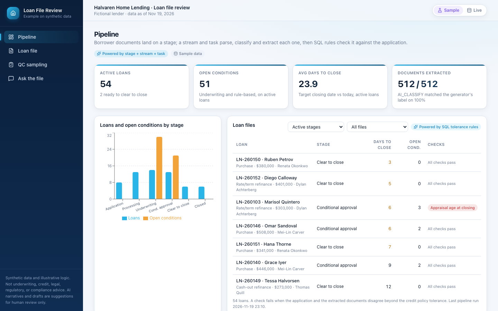

# Mortgage Loan File Review · Lintora File Desk

Help loan processors and QC reviewers extract borrower documents, verify them against the application, and clear conditions faster.

**[Guide](https://sfc-gh-ooral.github.io/sfguide-loan-file-review/)** · **[Try the example](https://sfc-gh-ooral.github.io/sfguide-loan-file-review/try/)** (no account needed)

> Synthetic data and illustrative logic only. Not underwriting, credit, legal, regulatory or compliance advice. This is an example, not an official Snowflake product, and it isn't supported by Snowflake Support.



## What it does

The app is **Lintora File Desk**, a fictional product brand used only in this example (design notes in [docs/DESIGN.md](docs/DESIGN.md)).

A fictional lender, Halvaren Home Lending, has 60 mortgage loan files with 512 borrower documents: loan application summaries, pay stubs, W-2s, bank statements, appraisal summaries, title commitments and closing disclosures. Each PDF lands on a Snowflake stage. A stream on the stage's directory table queues it, and a task runs one procedure that:

1. reads the document with **AI_PARSE_DOCUMENT** (OCR and layout),
2. names its type with **AI_CLASSIFY**,
3. pulls the fields for that type with **AI_EXTRACT**, with a confidence score per field and table extraction for bank statement deposits,
4. checks the documents against the application in SQL with tolerances from a `CREDIT_POLICY` table (income vs pay stub, employer, borrower name, large non-payroll deposits, appraisal age at closing, appraised value, loan amount, property address) and opens a condition for every failure, and
5. writes a QC narrative per loan with **AI_COMPLETE**.

A processor can also press **Re-extract** on any document in the loan file. In Live mode that calls the `REEXTRACT_DOCUMENT` procedure, which puts the file back on the queue and runs the same procedure, so **AI_PARSE_DOCUMENT**, **AI_CLASSIFY** and **AI_EXTRACT** run again on that file while you watch; the checks, conditions and QC narrative for the loan update with it.

**Cortex Search** indexes each loan's parsed documents and conditions, so a processor can ask questions about one file and get answers with citations. **AI_COMPLETE** also drafts a borrower email for any open condition.

| Screen | What you see |
| --- | --- |
| Pipeline | A stage line of loans and open conditions per stage, KPI tiles, a sortable and filterable work queue, the files that need a human, closing horizon and processor workload |
| Loan file | A three-pane workspace: document checklist with extraction progress and confidence; application vs documents with mismatches highlighted and a link to the source; conditions with **Clear**, **Draft borrower request** (AI-drafted message) and **Escalate to underwriter**; and a document drawer with the parsed page, its extracted fields and a **Re-extract** button |
| QC sampling | Findings by type (12 months of post-closing QC and today's failed checks), the pre-closing sample, an AI QC narrative per loan, and the credit policy tolerances |
| Ask the file | Questions such as "What's the borrower's verified monthly income?" answered from one loan's documents with numbered citations |

Planted stories on this synthetic data set (details in [data/README.md](data/README.md)): stated income 18% higher than the pay stubs support (LN-260101), an $18,500 unexplained deposit (LN-260102), an appraisal that will be 168 days old at closing against a 120-day policy (LN-260103), and a clean file ready to clear to close (LN-260104). In our run, those three failures were the only failed checks across all 60 loans.

## Prerequisites

- **No-account mode:** Node.js 20.19 or later. Nothing else.
- **Live mode:**
  - A Snowflake account (any edition) where Cortex AI functions and Cortex Search are available in your region, or with [cross-region inference](https://docs.snowflake.com/en/user-guide/snowflake-cortex/cross-region-inference) enabled. Tested in AWS US East 1 in November 2026.
  - The `claude-sonnet-4-5` model for AI_COMPLETE. Set `SNOWFLAKE_COMPLETE_MODEL` and edit the procedure in `sql/setup.sql` to use another [supported model](https://docs.snowflake.com/en/sql-reference/functions/ai_complete-single-string).
  - ACCOUNTADMIN for Part 1 of setup, or a role that can create roles, warehouses, databases and API integrations and grant EXECUTE TASK.
  - Outbound access from Snowflake to github.com (setup clones this public repository through a Git repository object).
  - Key-pair authentication for the user that runs the app.

## Quick start: no account

```bash
git clone https://github.com/sfc-gh-ooral/sfguide-loan-file-review.git
cd sfguide-loan-file-review
npm install
npm run dev
```

Open http://localhost:3000. The app runs on bundled responses captured from the live pipeline on the same synthetic data. AI output is labeled **Sample AI response**, and it waits a few seconds with staged progress steps to mirror the live calls. In Sample mode, Ask the file has captured answers for the suggested questions on the four story loans and 12 others, and Draft borrower request has captured drafts for the open conditions on the story loans.

## Live mode: deploy to your account

1. Open `sql/setup.sql` in a Snowsight SQL worksheet and run it top to bottom. Part 1 runs as ACCOUNTADMIN; everything else runs as the least-privilege role `LOAN_REVIEW_DEMO_ROLE`. The final three queries show how many documents were parsed and classified correctly, the result of every check, and the four planted stories.
2. Create a key pair and register the public key on your user (commands in `.env.example`).
3. Copy `.env.example` to `.env.local` and fill in the account, user and key path.
4. Run `npm run dev` and switch the work bar to **Live**. Every screen now reads from `LOAN_REVIEW_DEMO`; Re-extract, Regenerate, Draft borrower request, Ask, Clear and Escalate call Snowflake, and the badges show measured latency. If a live call fails, the app shows the error rather than sample data.

To see the pipeline pick up a new file, upload a PDF to the stage, add a manifest row, and refresh the directory table. The task runs within five minutes (or run `EXECUTE TASK PROCESS_DOCS_TASK`):

```sql
USE ROLE LOAN_REVIEW_DEMO_ROLE;
USE SCHEMA LOAN_REVIEW_DEMO.LOANS;
-- PUT file:///path/to/DOC-0999-pay-stub.pdf @LOAN_DOCS AUTO_COMPRESS = FALSE;  (SnowSQL or Snowflake CLI)
INSERT INTO DOCUMENTS VALUES ('DOC-0999', 'LN-260101', NULL, 'DOC-0999-pay-stub.pdf', CURRENT_TIMESTAMP(), 'Borrower upload');
ALTER STAGE LOAN_DOCS REFRESH;
```

To try a different credit policy, change a threshold and the checks follow, for example `UPDATE CREDIT_POLICY SET threshold = 0.20 WHERE rule_id = 'income';` (new rule failures open conditions on the next pipeline run).

### Objects created

| Object | Name | Purpose |
| --- | --- | --- |
| Role | `LOAN_REVIEW_DEMO_ROLE` | Owns everything below; granted to the user who runs setup |
| Warehouse | `LOAN_REVIEW_WH` | XSMALL, AUTO_SUSPEND = 60 |
| API integration | `LOAN_REVIEW_GIT_API` | Read-only access to this public repository |
| Database | `LOAN_REVIEW_DEMO` | Schemas `LOANS` and `APP` |
| Git repository | `LOANS.LOAN_REPO` | Source of the synthetic CSVs and documents |
| Stages | `LOANS.LOAN_SEED`, `LOANS.LOAN_DOCS` | Seed CSVs; incoming documents (directory table enabled) |
| Stream | `LOANS.LOAN_DOCS_STREAM` | New files on the document stage |
| Task | `LOANS.PROCESS_DOCS_TASK` | Every 5 minutes, only when the stream has data |
| Procedures | `LOANS.PROCESS_NEW_DOCUMENTS`, `LOANS.REEXTRACT_DOCUMENT` | Parse, classify, extract, open rule conditions, write QC narratives; re-run that for one document from the app |
| Function | `LOANS.NUM` | Normalizes extracted amounts |
| Tables | `LOANS`, `DOCUMENTS`, `CONDITIONS`, `QC_FINDINGS`, `CONFIG`, `CREDIT_POLICY`, `EXTRACTION_SCHEMAS`, `DOC_QUEUE`, `DOC_PARSED`, `DOC_FIELDS`, `QC_REVIEWS`, `APP.LOAN_ACTIONS` | Reference data, pipeline output and processor decisions |
| Views | `LOAN_DEPOSITS`, `LOAN_FACTS`, `LOAN_CHECKS`, `LOAN_CHECKLIST`, `LOAN_FACT_SHEET`, `LOAN_FILE_CHUNKS` | Tolerance checks, checklist, AI input, search corpus |
| Cortex Search service | `LOANS.LOAN_FILE_SEARCH` | Q&A over each loan file, filtered by loan |

### Expected cost and time

Measured on an XSMALL warehouse in AWS US East 1, November 2026, for the 512 bundled documents:

| | Measured |
| --- | --- |
| Setup time | 11 to 27 minutes end to end in two runs on a shared account (11.2 minutes on November 20, 2026; 27 minutes earlier when other workloads were running AI functions). Almost all of it is the first pipeline pass. In the faster run 13 of 512 extractions came back empty on the first pass; calling `PROCESS_NEW_DOCUMENTS()` once more (or waiting for the task) filled them in about a minute |
| Cortex AI credits per full setup | About 18 from the AI SQL usage history: AI_EXTRACT 17.4 (about 0.034 credits per document), AI_CLASSIFY 0.4, AI_COMPLETE 0.5. AI_PARSE_DOCUMENT is billed per page (512 one-page PDFs) and wasn't in that usage view when we measured; see the consumption table for its rate |
| Warehouse credits | 0.54 to 0.93 per setup plus live testing in our two runs (metering history lags, so the lower figure may be partial); the warehouse suspends after 60 seconds |
| Live app latency | Varied with account load across our two runs. Screens: 1–3 s after the first call in one run, 10–15 s in the other (the first call opens the connection). Borrower request draft 3.3–6.0 s; Ask the file 3.1–14 s; Regenerate QC narrative 12–20 s; Re-extract one document 62–75 s in three runs on November 20, 2026 (it re-parses, re-classifies and re-extracts the file, then rewrites the loan's QC narrative). Each badge in the app shows the measured time |

Most of the cost is AI_EXTRACT. To try it more cheaply on your own documents, start with a small sample or fewer fields. The task's `WHEN SYSTEM$STREAM_HAS_DATA` check doesn't start the warehouse while no files arrive. Costs depend on your region, model, document length and pricing; check the [Snowflake Service Consumption Table](https://www.snowflake.com/legal-files/CreditConsumptionTable.pdf).

### Clean up

Run `sql/cleanup.sql`. It drops the database (and with it every table, stage, file, stream, task, procedure, view and search service), the warehouse, the API integration and the role. It drops objects as `LOAN_REVIEW_DEMO_ROLE` first, because ACCOUNTADMIN doesn't inherit that role's ownership, so run it before you revoke the role from yourself.

## Known limitations

- Verified income is the latest pay stub's gross pay times pay periods per year, for one salaried borrower. There are no co-borrowers, hourly, overtime, bonus, rental or self-employment income, and the W-2 is shown for context, not used in the rule.
- The tolerance checks are simple illustrative rules, not agency, investor or regulatory guidelines. Payroll deposits are recognized by their description text.
- AI_EXTRACT confidence for the appraisal summaries came back lower (lowest field around 57–78%, mostly the appraiser name) on these synthetic one-page documents. The app shows each score so people can review those fields. Bank statements use a table schema, which doesn't return scores.
- AI function calls can return NULL when a call fails, for example under heavy load. The procedure retries documents with an empty type or empty fields on its next run, and withdraws any open rule condition whose check no longer fails once the documents extract.
- New documents need a manifest row that links them to a loan, and internal stages need `ALTER STAGE ... REFRESH` before the stream sees new files.
- Draft borrower request records the request and the drafted message in `APP.LOAN_ACTIONS`; it doesn't send email. Escalate records a note; there is no underwriter queue.
- The app connects as one role. There is no row-level separation between processors in this example.
- Ask the file retrieves six excerpts per question, so broad questions about the whole file can miss documents; specific questions work best.
- Sample mode keeps your decisions in memory for the current session only.

## Customize with Cortex Code

- "Add my document types and extraction fields, and test them on 10 sample files. Show the fields and confidence you get before changing `EXTRACTION_SCHEMAS`."
- "Change the income tolerance rules to match my credit policy and show the affected loans in `LOAN_CHECKS` before and after."
- "Export QC findings in my investor reporting format."

## Project layout

```text
app/                 Next.js screens (pipeline, loan file, QC sampling, ask) and the /api/data route
components/          Shell (icon rail, work bar), brand mark, Sample/Live switch, staged AI progress, UI kit
lib/live-data.ts     Live mode: Snowflake queries with bind variables
lib/mock-data.ts     No-account mode: responses captured from the live app
scripts/             Data generator, sample capture, hosted-example build, screenshots
sql/                 setup.sql and cleanup.sql
data/                Synthetic CSVs and documents (see data/README.md)
docs/                GitHub Pages guide and DESIGN.md; docs/try/ is the hosted no-account example
```

Check the design tokens against WCAG AA with `node scripts/check-contrast.mjs`. Regenerate the data with `python3 scripts/generate_data.py` (needs reportlab). Rebuild the hosted example with `npm run build:example`. Refresh the sample data from a live deployment with `node scripts/capture-sample.mjs` while `npm run dev` runs in Live mode.

## License

Apache 2.0. See [LICENSE](LICENSE) and [LEGAL.md](LEGAL.md). This is an illustrative example provided as-is. It is not an official Snowflake product and isn't supported by Snowflake Support. It contains no customer data. Review and test before any production use.

Owner: Oz Oral · Last reviewed: November 2026
